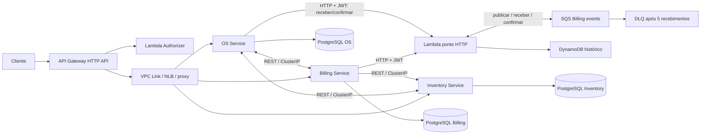

# Arquitetura distribuída — Fase 4

Diagramas para a apresentação: [divisão dos microsserviços](diagram-fase4-dominios.md) e [entrada HTTP e segurança](diagram-fase4-entrada-seguranca.md).

## Limites dos serviços

| Serviço | Responsabilidade | Persistência | Endereço interno |
| --- | --- | --- | --- |
| [OS](https://github.com/PosTech15SOAT/numberone-service-order) | Clientes, veículos, ordens e orquestração da Saga | Database lógico `numberone_os` no PostgreSQL; histórico veicular projetado no DynamoDB | `http://numberone-os-service.numberone-os.svc.cluster.local:8080` |
| [Billing](https://github.com/PosTech15SOAT/numberone-billing-service) | Orçamentos, aprovação, cobrança e eventos de pagamento | Database lógico `numberone_billing` no PostgreSQL | `http://numberone-billing-service.numberone-billing.svc.cluster.local:8080` |
| [Inventory](https://github.com/PosTech15SOAT/numberone-inventory-service) | Catálogo, preços, consumo e reversão de estoque | Database lógico `numberone_inventory` no PostgreSQL | `http://numberone-inventory-service.numberone-inventory.svc.cluster.local:8080` |

Os três databases lógicos compartilham uma instância RDS por restrição do laboratório, com usuários e credenciais separados. Cada aplicação executa suas próprias migrations. Nenhum serviço deve consultar diretamente o database de outro. A tabela DynamoDB de histórico é declarada no [repositório Database](https://github.com/PosTech15SOAT/postech15soat-infra-database); a projeção pertence à OS.

## Comunicação

O API Gateway atende chamadas externas e usa o Lambda Authorizer nas rotas protegidas. REST entre Pods usa os Services ClusterIP, sem passar pelo Gateway externo. O MVP não autentica chamadas REST serviço a serviço; essa limitação está registrada nos serviços. A ponte HTTP **exige** JWT do ServiceAccount e foi escolhida pela equipe porque o Academy Lab impede criar ou alterar roles para acesso direto dos Pods ao SQS. O transporte ativo e as flags de cada deploy precisam ser confirmados no ambiente antes da demonstração.

Billing publica eventos por outbox; a OS consome com inbox idempotente e mantém o estado da Saga. A fila Standard usa entrega pelo menos uma vez, DLQ e redrive após cinco recebimentos. O contrato de mensagens, repetição e recuperação está em [SQS Billing](sqs-billing-fase4.md) e nos [contratos da Saga](https://github.com/PosTech15SOAT/numberone-service-order/tree/main/doc/contracts/saga/v2). A OS coordena compensações por REST com Billing e Inventory. O histórico veicular é uma projeção, e não a fonte transacional da OS.

## Evidências necessárias para encerrar a Fase 4

- [ ] Confirmar no deploy as URLs da ponte, `OUTBOX_ENABLED`, `BILLING_SQS_ENABLED` e `HISTORY_DYNAMODB_ENABLED`, sem divulgar secrets.
- [ ] Executar uma OS completa entre os três serviços na AWS e registrar IDs de correlação, estados da Saga, outbox, inbox, estoque, pagamento e histórico.
- [ ] Exercitar falha e compensação com evidência de saldo e estado final; validar redrive/DLQ separadamente.
- [ ] Demonstrar logs, métricas ou traces correlacionados no Datadog.
- [ ] Vincular os resultados de CI, cobertura, análise de qualidade, BDD e contratos de API nos READMEs dos serviços.
- [ ] Publicar vídeo de até 15 minutos e PDF final com participantes, links, este diagrama, divisão dos serviços e justificativa da Saga.

O sucesso de Terraform Apply, rollout e health check comprova implantação básica. Ele não comprova, isoladamente, as integrações e compensações acima.
