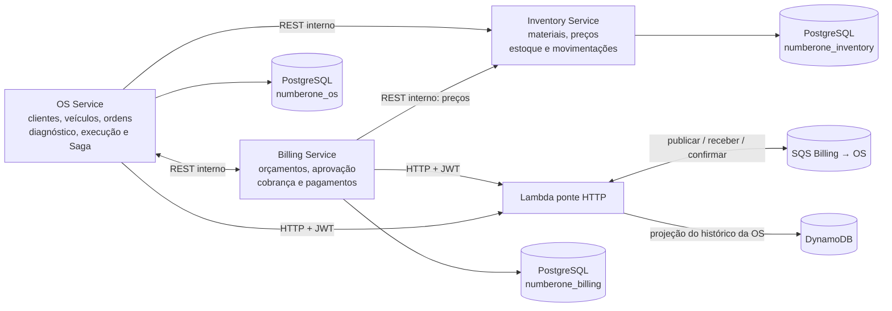

# Fase 4 — divisão dos microsserviços

Use este diagrama na apresentação de arquitetura e decomposição. Cada serviço controla seus dados; os três databases lógicos estão na mesma instância RDS do laboratório.

A OS orquestra a Saga. Billing e Inventory confirmam suas próprias operações; nenhum serviço acessa diretamente o database de outro. Consulte a [arquitetura completa](architecture-fase4.md) para a entrada HTTP, a ponte JWT e a DLQ.
