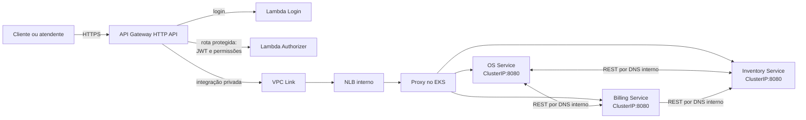

# Fase 4 — entrada HTTP e segurança

Use este diagrama para explicar o caminho das requisições externas até os microsserviços. As rotas públicas e protegidas seguem a configuração do API Gateway.

O Gateway recebe chamadas externas e aciona o Authorizer nas rotas protegidas. REST entre os Pods usa DNS e Services ClusterIP, sem passar pelo Gateway. A comunicação REST interna do MVP não autentica a identidade do serviço chamador. A ponte HTTP de SQS/DynamoDB tem autenticação própria com JWT temporário do ServiceAccount, explicada na [arquitetura completa](architecture-fase4.md).
