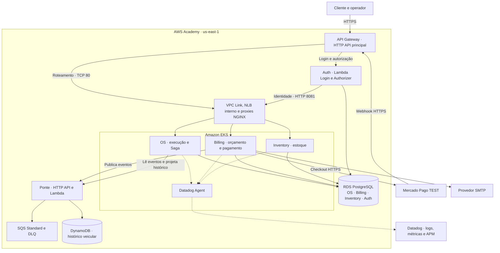

# Diagrama de componentes · NumberOne Fase 4

- **Entrada.** O API Gateway recebe HTTPS e invoca Login ou Authorizer conforme a rota. As rotas de aplicação usam VPC Link, listener `80` e NGINX até os Services `ClusterIP` na porta `8080`. A consulta privada de identidade usa o listener `8081` do NLB e um proxy dedicado que alcança apenas a rota de identidade da OS. [Matriz de rotas e ingresso privado](../gateway-fase4.md)
- **Dados.** OS, Billing e Inventory usam `numberone_os`, `numberone_billing` e `numberone_inventory`. Auth usa `numberone_auth`, com runtime de leitura. Os segredos de conexão e a chave JWT ficam no Secrets Manager. A OS projeta o histórico veicular no DynamoDB pela ponte. [Configuração do Database](https://github.com/PosTech15SOAT/postech15soat-infra-database/blob/main/docs/phase4.md)
- **Mensageria.** A direção de negócio é Billing → OS. As setas dos dois pods para a ponte representam chamadas de infraestrutura de publicação, leitura e confirmação. A ponte autoriza a operação pela identidade do pod. A regra de negócio permanece nos microsserviços. [Configuração da ponte e das filas](../sqs-billing-fase4.md)
- **REST entre serviços.** A OS consulta e resolve consumo no Inventory e consulta quitação e solicita cancelamento no Billing. O Billing consulta composição na OS e preços no Inventory. Essas chamadas usam o DNS interno dos Services. [ADR de comunicação](adr/001-rest-sqs-saga.md)
- **Observabilidade.** Os microsserviços enviam telemetria ao Datadog Agent. O cruzamento do `correlationId` com o `eventId` permite ligar registros do Billing e da OS mesmo quando a jornada atravessa o SQS. [Módulo de observabilidade](../../infra/modules/observability/README.md)
