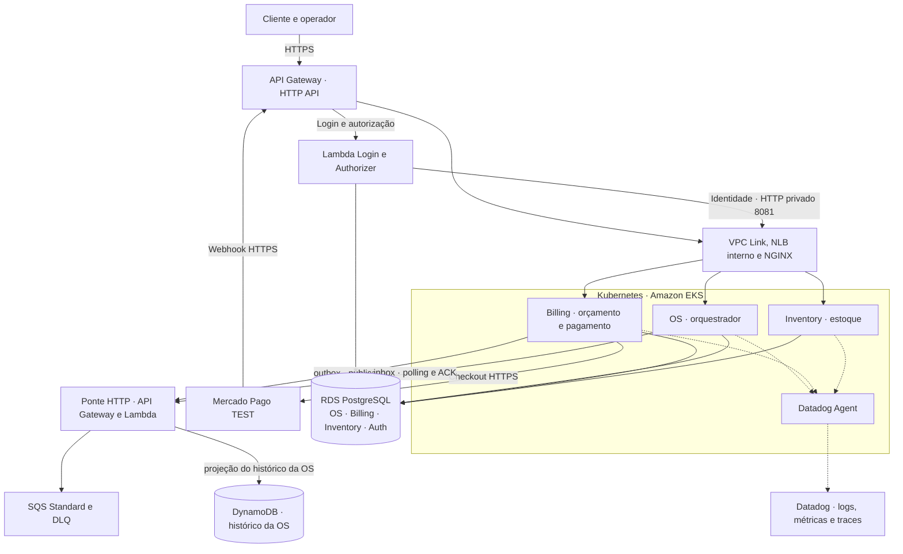

# NumberOne · Tech Challenge Fase 4

**Prévia do PDF de entrega · Arquitetura revisada em 17 de novembro de 2026**

O NumberOne é uma aplicação de gestão de oficinas. Ela foi dividida em três microsserviços para dar a cada domínio controle sobre seus dados e manter consistente a jornada de uma ordem de serviço, mesmo quando estoque, cobrança ou mensageria falham.

## Equipe

| Participante | Identificação acadêmica |
| --- | --- |
| Matheus | Nome completo e RM a confirmar |
| Júlio | Nome completo e RM a confirmar |
| Anderson | Nome completo e RM a confirmar |
| Marcelo | Nome completo e RM a confirmar |

**Vídeo de demonstração** · inserir o link público ou não listado do YouTube/Vimeo, com duração máxima de 15 minutos.

## Repositórios

| Repositório | Escopo |
| --- | --- |
| [numberone-service-order](https://github.com/PosTech15SOAT/numberone-service-order) | OS e orquestração |
| [numberone-billing-service](https://github.com/PosTech15SOAT/numberone-billing-service) | Orçamento, pagamento e outbox de eventos comerciais |
| [numberone-inventory-service](https://github.com/PosTech15SOAT/numberone-inventory-service) | Estoque e movimentações |
| [postech15soat-infra-cloud](https://github.com/PosTech15SOAT/postech15soat-infra-cloud) | VPC, EKS, ECR, Gateway, SQS, ponte e observabilidade |
| [postech15soat-infra-database](https://github.com/PosTech15SOAT/postech15soat-infra-database) | RDS PostgreSQL, DynamoDB, credenciais de aplicação e inicialização dos bancos |
| [numberone-app-auth](https://github.com/PosTech15SOAT/numberone-app-auth) | Lambdas Login e Authorizer, JWT, perfis e permissões |
| [postech15soat-governance](https://github.com/PosTech15SOAT/postech15soat-governance) | Rulesets e promoção de branches |
| [numberone-app-auto-service-api](https://github.com/PosTech15SOAT/numberone-app-auto-service-api) | Monólito de referência da Fase 3 |

OS, Billing e Inventory estavam públicos na conferência de 17/11. Confira o acesso às evidências de entrega com a mesma visibilidade usada pelo avaliador.

## Arquitetura

O diagrama resume a arquitetura da Fase 4 na AWS Academy. Os runs de referência registram a Cloud em `full`, os quatro bancos validados e o deploy do Auth. [Cloud](https://github.com/PosTech15SOAT/postech15soat-infra-cloud/actions/runs/44140584016) · [PostgreSQL](https://github.com/PosTech15SOAT/postech15soat-infra-database/actions/runs/44164971101) · [Auth](https://github.com/PosTech15SOAT/numberone-app-auth/actions/runs/44173375280)

OS, Billing e Inventory usam conexões e usuários exclusivos na mesma instância RDS. Auth usa um quarto banco lógico para credenciais, perfis e permissões. As Lambdas consultam a identidade de cliente na OS por HTTP privado, enquanto a entrada pública mantém HTTPS e autorização por rota. A OS é dona da projeção DynamoDB.

### Documentação complementar

O pacote de entrega reúne o diagrama de componentes detalhado, a sequência de autenticação e abertura da OS, os RFCs de nuvem, persistência e autenticação e os ADRs de comunicação, fronteiras de acesso e HPA. O guia do Júlio registra o procedimento de reconstrução após reset da AWS Academy. O [índice da documentação](README.md) reúne os complementos e o guia de implantação. Os repositórios de aplicação mantêm seus diagramas, decisões e contratos específicos.

## Divisão de responsabilidades e escolhas técnicas

| Decisão | Justificativa |
| --- | --- |
| OS reúne diagnóstico e execução | A aprovação congela o escopo técnico. Iniciar, concluir e entregar dependem do estado da mesma ordem. O orquestrador usa esse estado para decidir o próximo passo. |
| Billing reúne orçamento e pagamento | Uma revisão vincula a versão da composição da OS, os preços usados e o valor aprovado. A cobrança e o webhook pertencem ao mesmo serviço que conhece esse valor. |
| Inventory é independente | O saldo pode mudar por entradas, baixas e reversões. O Inventory serializa as operações e mantém o histórico de movimentações, reaproveitando suas regras para OS e Billing. |
| Java 25 na OS e no Billing, Java 21 no Inventory | Mantém a base técnica de cada repositório. Spring Boot expõe APIs, health e componentes de integração. As camadas de aplicação e domínio separam casos de uso dos adaptadores. |
| PostgreSQL e Flyway | Servem aos estados transacionais e às restrições locais. Flyway controla as migrations de cada esquema sob o serviço proprietário. |
| DynamoDB | Atende ao histórico de revisão veicular, consultado por veículo, com projeção idempotente e paginação. |
| HTTP e SQS Standard | HTTP dá respostas imediatas de estoque e quitação. SQS distribui fatos de orçamento e pagamento de forma assíncrona e aceita reentrega. Versões, inbox e reconciliação tratam entregas repetidas ou fora de ordem. |
| Mercado Pago Checkout Pro com Orders | Billing cria a Order de checkout e confirma o estado consultando o provedor após webhook assinado. A homologação realizada foi no ambiente Teste. |
| Docker, Kustomize, GitHub Actions, ECR/EKS | Imagens por serviço, manifests declarativos e esteiras independentes de build, testes e rollout. |
| Datadog e correlação | A Cloud instala o Agent via Helm. Use `correlationId` e `eventId` para vincular chamadas REST e eventos do SQS à evidência da jornada. |

## Saga orquestrada

O orquestrador fica na OS porque ela decide quando um item pode começar, quando o reparo está concluído, o que compensar e quando liberar a entrega. Cada participante mantém seu próprio resultado. A OS grava estado e intenções no PostgreSQL, faz chamadas remotas entre transações locais e revalida as condições antes de gravar o efeito.

| Etapa | Operação e confirmação |
| --- | --- |
| Abertura e diagnóstico | A OS registra veículo, trabalho e materiais planejados e versiona a composição. A criação de orçamento é uma operação do Billing. |
| Orçamento | Billing consulta composição e preços, persiste a revisão e publica envio, aprovação ou rejeição. OS valida versão, escopo e identidade. Uma decisão sem evento de envio correspondente pode ser reconciliada por CT-10. Rejeição leva a `WAITING_REVISION`. |
| Execução | A OS grava a intenção e chama Inventory com `operationId`. Consumo confirmado libera o início. Saldo insuficiente faz o item aguardar peças. Timeout mantém a operação pendente e permite consultar CT-08 ou repetir com a mesma chave. |
| Conclusão | A OS aguarda os itens elegíveis, conclui o reparo e grava um registro de outbox para projetar o histórico no DynamoDB. A Saga aguarda pagamento. |
| Pagamento e entrega | Billing confirma a quitação local e publica `PagamentoConfirmado`. A inbox da OS aplica o evento e agenda verificação. A entrega consulta CT-07, revalida o estado local e registra `DELIVERED` na OS e `COMPLETED` na Saga. Pagamento recusado ou pendente mantém a entrega bloqueada. |

### Idempotência e compensação

- **Outbox e inbox.** Billing grava a mudança e o evento no mesmo commit. O relay publica o envelope no SQS. A OS deduplica por `eventId` e hash, grava o efeito com o desfecho da inbox e confirma a mensagem após o commit. Eventos usam `eventId`, `eventType`, `schemaVersion`, `occurredAt`, `correlationId` e `payload` versionado.
- **Cancelamento pré-execução.** Com cancelamento integral elegível e ausência de uso físico confirmada, a OS registra a evidência, bloqueia novos inícios e resolve as tentativas de estoque. `CLOSED` encerra sem baixa. `REVERSED` registra a devolução conferida e conserva o movimento original. Em seguida, CT-09 ou CT-11 fecha o orçamento ou o contexto comercial. A OS encerra em `COMPENSATED` após as confirmações.
- **Resultado inconclusivo ou intervenção.** Uma resposta perdida não comprova ausência do efeito. A OS mantém as chaves e retoma a operação. Execução iniciada, uso físico, cancelamento parcial ou efeito financeiro inconclusivo podem exigir revisão operacional. Um estorno integral confirmado muda a quitação. A decisão de solicitar estorno e a coordenação com a entrega seguem a política acordada pela equipe.

## Evidências e checklist de entrega

| Critério do enunciado | Evidência ou pendência |
| --- | --- |
| Três microsserviços, repositórios e dados isolados | O Job de inicialização validou OS, Billing e Inventory e o banco adicional do Auth. [Run de inicialização](https://github.com/PosTech15SOAT/postech15soat-infra-database/actions/runs/44164971101) |
| REST, mensageria e Saga documentada | Contratos da OS, documentação de cada repositório e homologação local com SQS/DLQ. Repetir com as revisões e a política interna que forem promovidas. |
| SQL e NoSQL | PostgreSQL por serviço e adaptador DynamoDB do histórico já implementado na OS. Comprovar escrita e consulta do histórico no ambiente final. |
| Testes unitários e cobertura de pelo menos 80% | Relatórios de CI nas branches de evidências. OS 93,45%, Billing 94,08% e Inventory 84,57% de linhas. Recolher os relatórios dos SHAs promovidos. [OS](https://github.com/PosTech15SOAT/numberone-service-order/pull/8/checks) · [Billing](https://github.com/PosTech15SOAT/numberone-billing-service/pull/6/checks) · [Inventory](https://github.com/PosTech15SOAT/numberone-inventory-service/pull/6/checks) |
| Pelo menos um fluxo completo com BDD | Em 17/11, passaram 2 cenários e 12 etapas com as revisões de `develop` de OS, Billing e Inventory, SQS no LocalStack e Mercado Pago simulado. A execução verificou entrega após confirmação de pagamento e compensação por falta de estoque. [Relatório, JUnit e SHAs](https://github.com/PosTech15SOAT/numberone-service-order/blob/develop/doc/evidencias/fase-4/bdd-saga-2026-11-17/README.md) |
| SonarQube ou equivalente integrado ao CI | Os três PRs integrados em `develop` acrescentam `pmd:check` 3.28.0 à validação obrigatória, com bloqueio de violações de prioridade 1 e 2 e publicação de `target/pmd.xml`. Para a versão de entrega, guardar os relatórios da revisão promovida à `main`. [OS #19](https://github.com/PosTech15SOAT/numberone-service-order/pull/19) · [Billing #17](https://github.com/PosTech15SOAT/numberone-billing-service/pull/17) · [Inventory #16](https://github.com/PosTech15SOAT/numberone-inventory-service/pull/16) |
| Docker, manifests, CI/CD e deploy Kubernetes | Os workflows de deploy em `main` concluíram com health check no EKS. Use um deles como evidência no vídeo. [OS](https://github.com/PosTech15SOAT/numberone-service-order/actions/runs/44171381008) · [Billing](https://github.com/PosTech15SOAT/numberone-billing-service/actions/runs/44168213146) · [Inventory](https://github.com/PosTech15SOAT/numberone-inventory-service/actions/runs/44166470357) |
| `main` protegida por PR e checks obrigatórios | Regras ativas em OS, Billing e Inventory, com PR obrigatório, CI verde e bloqueio de exclusão e force push. Inventory está público. [OS](https://github.com/PosTech15SOAT/numberone-service-order/rules) · [Billing](https://github.com/PosTech15SOAT/numberone-billing-service/rules) · [Inventory](https://github.com/PosTech15SOAT/numberone-inventory-service/rules) · [Governança](https://github.com/PosTech15SOAT/postech15soat-governance/pull/13) |
| Arquitetura, documentação da Saga e API por repositório | Consultar o [pacote integrado na Cloud](README.md) e conferir as referências para a arquitetura e a API de cada microsserviço. O ADR de escalabilidade registra réplicas fixas no lab de referência e HPA em avaliação para os microsserviços. |
| Monitoramento e rastreamento distribuído | Cloud declara Datadog. Falta link ou captura sanitizada do fluxo executado no ambiente de entrega. |
| Vídeo de até 15 minutos | Gravar jornada completa, falha e compensação, deploy com validação e evidência de observabilidade. Inserir link YouTube ou Vimeo. |
| PDF no portal | Este Markdown é a primeira versão. Confirmar nomes, RMs, link do vídeo, revisões e diagrama final antes de diagramar. |
