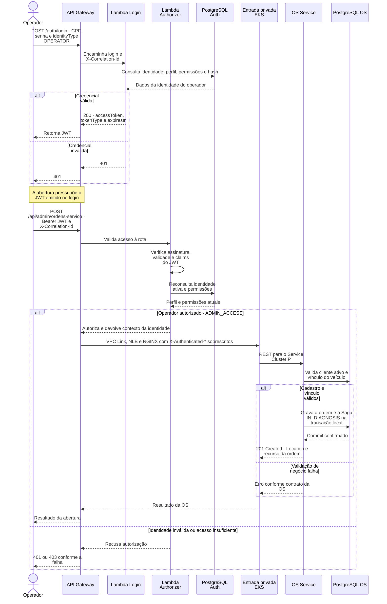

# Sequência · Autenticação e abertura de ordem de serviço

O cenário começa com um operador cadastrado no Auth e um cliente ativo e seu veículo cadastrados na OS. O operador usa HTTPS no Gateway em modo `full`. A abertura recebe `idCliente`, `idVeiculo` e `descricaoInicial`.

- O login de **cliente** adiciona uma consulta da Lambda à rota `POST /internal/auth/customer-identity` pelo listener privado `8081`. O Authorizer também checa esse vínculo para acesso do cliente a rotas de acompanhamento. A autorização administrativa do diagrama é de um operador. [Contrato de identidade](https://github.com/PosTech15SOAT/numberone-app-auth/blob/main/docs/fase-4-identidade.md)
- O `201` confirma a transação da abertura. Os eventos comerciais do Billing participam da Saga depois que houver orçamento. [Controller de abertura](https://github.com/PosTech15SOAT/numberone-service-order/blob/main/src/main/java/br/com/fiap/numberone/serviceorder/api/controllers/ServiceOrderController.java) · [Persistência de OS e Saga](https://github.com/PosTech15SOAT/numberone-service-order/blob/main/src/main/java/br/com/fiap/numberone/serviceorder/infrastructure/persistence/gateways/JpaServiceOrderGateway.java)
- Modo `full`, sobrescrita dos cabeçalhos e rotas administrativas estão declarados na Cloud. O teste sem token recebido pelo Gateway retornou `401`. A demonstração do `201` exige um operador válido e o par cliente–veículo. [Matriz do Gateway](../gateway-fase4.md)
